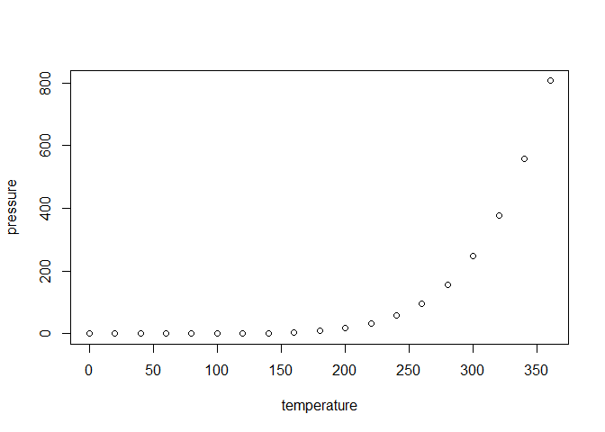

<!-- README.md is generated from README.Rmd. Please edit that file -->

# SHDmedian

`SHDmedian()` retains the exact bivariate cutting-plane implementation.
`SHDmedian_approx()` adds finite-direction SDP optimization in any
dimension, with a fixed center supplied explicitly:

``` r
set.seed(1)
X <- matrix(rnorm(300), 100, 3)
fit <- SHDmedian_approx(X, center = rep(0, 3), n_directions = 200, seed = 42)
fit$Sigma
fit$depth_U
fit$search_bounds
```

The approximate method defaults to the positive definite domain. Use
`domain = "psd"` for semidefinite matrices. Inspect `status`,
`search_bounds`, and `levels` for numerical uncertainty. `depth_U` uses
raw inclusive counts on the returned fixed directions; it is an upper
bound on full directional depth. The selected matrix is not a barycenter
of the median set.

See `doc/approximate-median.md`, `examples/approx.R`, and
`benchmarks/approx.R` for numerical details, independent validation, and
reproducible timings. The approximation requires the optional `clarabel`
package (`install.packages("clarabel")`).

<!-- badges: start -->

<!-- badges: end -->

The goal of SHDmedian is to …

## Installation

You can install the development version of SHDmedian like so:

``` r
# FILL THIS IN! HOW CAN PEOPLE INSTALL YOUR DEV PACKAGE?
```

## Example

This is a basic example which shows you how to solve a common problem:

``` r
library(SHDmedian)
## basic example code
```

What is special about using `README.Rmd` instead of just `README.md`?
You can include R chunks like so:

``` r
summary(cars)
#>      speed           dist       
#>  Min.   : 4.0   Min.   :  2.00  
#>  1st Qu.:12.0   1st Qu.: 26.00  
#>  Median :15.0   Median : 36.00  
#>  Mean   :15.4   Mean   : 42.98  
#>  3rd Qu.:19.0   3rd Qu.: 56.00  
#>  Max.   :25.0   Max.   :120.00
```

You’ll still need to render `README.Rmd` regularly, to keep `README.md`
up-to-date. `devtools::build_readme()` is handy for this.

You can also embed plots, for example:



In that case, don’t forget to commit and push the resulting figure
files, so they display on GitHub and CRAN.
